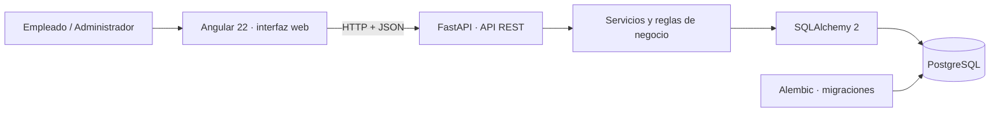
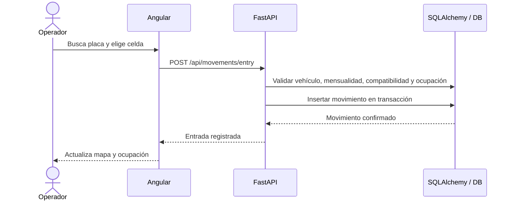

# Arquitectura de la aplicación

## Vista de componentes



Se utiliza un monolito modular, no microservicios. La API es la única responsable de validar operaciones y conectar con la base de datos. Angular no se conecta directamente con PostgreSQL.

## Flujo de ingreso



Al salir se asigna la fecha de salida al movimiento activo. La disponibilidad se vuelve a calcular consultando movimientos sin salida; no hay que sincronizar un segundo estado de ocupación.

## Paquetes sugeridos en StarUML

```text
AutosColombia
├── clientes
├── vehiculos
├── parqueaderos
│   ├── sedes
│   ├── zonas
│   └── celdas
├── mensualidades
├── movimientos
├── novedades
└── reportes
```

## Configuración de datos

- `DATABASE_URL` apunta a PostgreSQL (`postgresql+psycopg://...`) y se lee desde `.env`.
- Si `DATABASE_URL` falta o no es de PostgreSQL, el backend no arranca: no existe respaldo en otro motor.
- Alembic crea/migra el esquema.
- El primer arranque crea el inventario de prueba. En un parqueadero nuevo no se precargan celdas: se deben agregar según el conteo físico.
- Las operaciones de ingreso validan estados en el servidor y además existen índices únicos parciales que protegen la celda y el vehículo ante solicitudes simultáneas.

## Módulos de la interfaz

La interfaz Angular se organiza en dos grupos de navegación:

- **Operación:** resumen operativo, ocupación y celdas, clientes, vehículos, mensualidades, historial, novedades, registrar ingreso, registrar salida y configuración operativa. Es el flujo del día a día: buscar una placa, validar su mensualidad, asignar una celda y liberar la salida.
- **Administración:** parqueaderos, empleados y turnos, reportes, configuración y tarifas y vigencias. Es el flujo de configuración del negocio: crear el parqueadero y su estructura, registrar quién opera, revisar el estado del día y administrar los precios por vigencia.

Ambos grupos consumen los mismos endpoints. La API es la única que valida y escribe; Angular solo presenta y solicita. El contexto de parqueadero se resuelve en la API: cada consulta lleva el identificador del parqueadero seleccionado y los datos de clientes, vehículos, celdas, empleados y tarifas quedan aislados por esa frontera.

## Pantalla de resumen operativo

La primera pantalla de Operación replica el frame de Figma "Operación · Resumen operativo" y se compone, en este orden, de:

1. **Ruta y fecha** y **encabezado** con las acciones "Registrar salida" y "Registrar ingreso".
2. **Indicadores** (4): vehículos dentro, celdas disponibles, vehículos registrados y pagos recibidos hoy.
3. **Estado de operación** (2 paneles): anillo de ocupación física (porcentaje sobre el inventario total, leyenda de ocupadas / libres operativas / mantenimiento y pastilla de sobrecapacidad) y disponibilidad por tipo (barras de capacidad de carros y camionetas y de motos, con celdas libres y en mantenimiento).
4. **Mensualidades** (3 cuadros): vigentes, próximas a vencer en los próximos 7 días y vencidas.
5. **Movimientos recientes**: tabla con hora, placa y tipo, cliente, movimiento y celda, y responsable; el enlace "Ver historial →" lleva al historial completo y cada ingreso activo ofrece la acción discreta "Registrar salida".
6. **Mensaje contextual** que declara que el inventario es de demostración y que la capacidad está por confirmar.

Los datos llegan de dos endpoints:

- `GET /api/dashboard` devuelve, además de los totales, `cells_maintenance`, `occupancy_by_group` (grupos disjuntos: `vehiculos` y `motos`) y `monthly_expiring_soon` (contratos que vencen en 7 días o menos, coherente con el texto del cuadro).
- `GET /api/movements` añade `entry_employee` y `exit_employee`; cuando no hay responsable registrado la interfaz muestra "Sesión demo", igual que en Reportes.

El anillo se dibuja con CSS (`conic-gradient` + centro blanco) en lugar de imágenes, para no depender de recursos externos y mantener el color del token de Figma.

## Pantalla de ocupación y celdas

La pantalla de Operación "Ocupación y celdas" replica el frame de Figma "Operación · Ocupación y celdas" y se compone, en este orden, de:

1. **Ruta y fecha** y **encabezado** con el título, el contexto de la sede consultada ("Inventario de Sede principal. Selecciona una celda para consultar su detalle.") y la acción primaria **Crear celda**.
2. **Indicadores** (4): total físico, ocupadas, libres operativas y en mantenimiento, con el icono `chart-no-axes-column.svg`.
3. **Búsqueda y filtros**: un campo de texto que busca por código de celda o placa y tres selectores (sede, zona y tipo de vehículo) con el mismo estilo del diseño.
4. **Mapa de celdas** (panel principal): título, leyenda de estados y las zonas del inventario. Las zonas de carros y camionetas se reparten en dos columnas, la banda "↓ CIRCULACIÓN · ACCESO / SALIDA ↑" separa el flujo de motos y la zona de motos ocupa el ancho completo. Cada celda es un botón de 55px con el código y su estado (libre, ocupada o mantenimiento); la celda enfocada se invierte en azul con borde de 2px.
5. **Detalle de celda** (columna de 320px): el primer panel muestra la celda enfocada (estado, zona/sede, compatibilidad y, si está ocupada, el vehículo, el propietario, el ingreso y las acciones "Ver movimiento activo" y "Registrar salida"); el segundo, "Configurar celda", permite pasarla a mantenimiento o reactivarla.
6. **Mensaje contextual** con el inventario de demostración y la capacidad por confirmar, y el pie de página del módulo.

Reglas de implementación:

- El mapa se deriva de los datos reales (`cells`, `zones`, `vehicles` y `movements`); no hay estado de ocupación en el cliente. Una celda ocupada es la que tiene un movimiento sin salida.
- La celda enfocada se controla con `mapCellId`, independiente del `selectedCellId` del flujo de ingreso. Si no hay selección explícita, se muestra la primera celda que pasa los filtros.
- La compatibilidad se escribe en minúsculas a partir del segundo tipo ("Carro y camioneta"), como en el diseño.
- El alta de celdas vive en un modal (`.dialog-backdrop` / `.dialog-card`) que conserva el formulario de zona, código y tipos permitidos, y el bloque "Capacidad por tipo" que calcula la capacidad por tipo sobre las celdas compatibles, sin duplicar celdas de varios tipos.
- Pasar una celda ocupada a mantenimiento está bloqueado en la interfaz con el mensaje del diseño; la API sigue siendo la única que valida la operación.

Endpoints utilizados: `GET /api/cells`, `GET /api/zones?site_id=`, `GET /api/vehicles`, `GET /api/movements`, `POST /api/cells` y `PATCH /api/cells/{id}/status`.

## Pantalla de clientes · directorio

La pantalla de Operación "Clientes" replica el frame de Figma "Clientes · Directorio" y se compone, en este orden, de:

1. **Ruta y fecha** y **encabezado** con el contexto de la sede consultada y la acción primaria **Registrar cliente**.
2. **Indicadores** (3): clientes registrados, vehículos asociados y clientes con más de un vehículo, con los iconos `users.svg`, `car.svg` y `files.svg`.
3. **Pestañas de corte**: "Todos los clientes", "Con vehículos dentro" y "Con mensualidad vencida".
4. **Búsqueda y filtros**: un campo de texto que busca por nombre, documento o celular, y dos selectores (estado de mensualidad y orden del listado).
5. **Tabla de clientes** con seis columnas: cliente, documento, contacto, vehículos, mensualidades y acciones ("Consultar · Editar").
6. **Paginación** con siete filas por página y una ventana de hasta cinco números de página; la página activa se distingue solo por su peso tipográfico.
7. **Aviso de alcance** con la sede consultada y el enlace "Ver vehículos →", más el pie de página del módulo.

Reglas de implementación:

- La tabla se deriva de los datos reales: `GET /api/customers` aporta el maestro de clientes y `GET /api/vehicles` sus vehículos, que la interfaz agrupa por `customer_id` para componer cada fila. No hay un endpoint de "directorio": la agregación vive en el cliente.
- El estado de mensualidad de la columna llega en el payload del vehículo (`monthly_status`) y la interfaz lo resume con su pluralidad real: "Sin contratos" (0 vehículos), "Vigente" (1 vigente), "N vigentes · $importe" (2 o más vigentes, sumando la tarifa de cada uno), "Próxima a vencer", "Vencida" y el caso mixto "1 vigente · 1 vencida".
- El buscador de la página tiene prioridad; si está vacío se aplica el término del buscador global del encabezado, que además reconoce placas, de modo que el buscador global nunca deja de filtrar el directorio.
- El alta y la edición comparten el modal del patrón `.dialog-backdrop` / `.dialog-card` ya usado en el módulo de celdas. "Registrar cliente" envía `POST /api/customers`; "Editar" abre el mismo formulario en modo edición y envía `PUT /api/customers/{id}`.
- `PUT /api/customers/{id}` responde 404 si el cliente no pertenece al parqueadero en contexto y 409 si el documento ya está registrado en ese parqueadero, igual que el alta.
- "Consultar" abre una ficha modal con los datos de contacto y los vehículos del cliente, cada uno con su estado de mensualidad.
- La demostración no siembra clientes ni vehículos: el directorio inicia con un estado vacío honesto (0 clientes) en lugar de datos ficticios verosímiles, y el enlace "Ver vehículos →" lleva al módulo de vehículos.

Endpoints utilizados: `GET /api/customers`, `GET /api/vehicles`, `POST /api/customers` y `PUT /api/customers/{id}`.

## Estructura de scroll de la aplicación

La interfaz funciona como un *app shell* de dos áreas de desplazamiento independientes:

- `.app-shell` ocupa el alto de la ventana (`height: 100vh`) y corta el desborde (`overflow: hidden`), de modo que el documento del navegador nunca genera scroll.
- `.sidebar` (menú lateral) es un contenedor de scroll: la lista `.nav` se desplaza dentro del panel azul con la marca y el pie siempre visibles, y el panel completo puede desplazarse si el alto de la ventana es muy pequeño. Usa `overscroll-behavior: contain` para no encadenar el gesto con el área de contenido.
- `.workspace` (área de contenido) es el contenedor de scroll principal, con `height: 100vh` y `overflow-y: auto`; la barra superior (`.topbar`) es `position: sticky` dentro de él, por lo que permanece visible al desplazar.

Al cambiar de módulo, `App.navigate()` devuelve el área de contenido al inicio (`scrollWorkspaceToTop()`), porque el contenedor conserva la posición al cambiar el contenido.

En pantallas de hasta 900px la media query revierte el comportamiento: `.app-shell`, `.sidebar` y `.workspace` pasan a `height: auto` y `overflow: visible`, y el documento del navegador vuelve a hacer el scroll completo.

## Límites de la prueba local

No hay autenticación de usuarios ni autorización por roles en esta primera versión. Los campos de empleado existen en el modelo, pero la interfaz no identifica al operador. Añadir login, gestión de empleados y auditoría firmada es condición previa para producción con datos personales.
